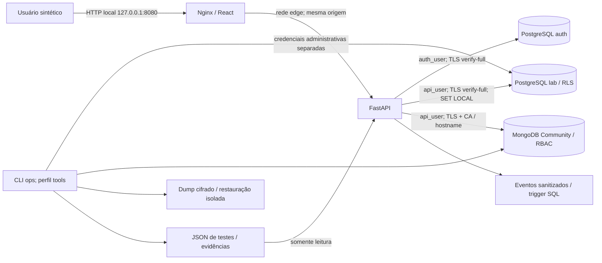

# Arquitetura e limites de confiança

O SecureDB Lab implementa os dois laboratórios da disciplina Tratamento e Armazenamento da Informação. React/TypeScript/Vite compõem a interface; FastAPI/Pydantic aplicam autenticação, autorização e validação; psycopg 3 e PyMongo acessam os bancos com verificação de CA e hostname.

## Fronteiras

1. **Navegador / servidor:** a empresa nunca é aceita no payload. A sessão opaca é persistida como hash SHA-256; seu mapeamento para a conta determina tenant e papel. Campos extras são rejeitados. Mudanças exigem Origin autorizado e token CSRF da sessão. A política SameSite e HttpOnly complementa esses controles.
2. **Servidor / PostgreSQL:** `auth_user` tem leitura de contas e operações de sessão. `api_user` herda leitura/escrita restritas de negócio; não lê hashes nem administra o banco. O proprietário `migration_owner` é NOLOGIN e não é herdado pela aplicação. Cada operação de negócio abre uma conexão/transação e define tenant e ator com `set_config(..., true)`.
3. **RLS:** tenants, customers e orders usam ENABLE e FORCE RLS. As políticas têm USING e WITH CHECK. A FK composta impede associar pedido a cliente de outra empresa. Roles privilegiadas e contexto de backend comprometido continuam sendo limites do desenho.
4. **Servidor / MongoDB:** usuário restrito a find/insert/update nas coleções products e profiles; sem administração, remoção ou bypass de validação. O escopo por empresa é aplicado pelo backend, sem alegação de RLS no MongoDB. `$jsonSchema`, índices únicos e validação strict/error são aplicados no SGBD.
5. **Operação:** o serviço ops é separado e opcional. Apenas ele recebe credenciais administrativas e chave de backup. A API recebe o diretório de evidências somente para leitura e nunca executa comandos de teste, backup ou restore pelo navegador.

## Redes e persistência

O Compose usa PostgreSQL 17.6 e MongoDB 8.0.15, volumes nomeados e healthchecks. Bancos conectam-se somente à rede interna `data` (172.29.74.0/24) e não publicam portas. Web publica apenas `127.0.0.1:8080`. A API liga as redes edge/data. `bindIp: 0.0.0.0` do MongoDB é necessário para acesso dos pares de rede e depende dessa segmentação; não representa proteção isoladamente. O host deve ter firewall compatível. ENV-01 inspeciona o contêiner e a rede efetivos, sem montar o socket Docker no runtime.

O perfil alternativo nativo Windows usa apenas `127.0.0.1:55432` e `127.0.0.1:57017` e pastas `.local/native`. Ele valida banco/API e TLS, mas não certifica a topologia de contêineres. A API local de desenvolvimento usa 127.0.0.1:8000 e o Vite 127.0.0.1:5173 com proxy de mesma origem.

## Segredos e criptografia

`scripts/lab.py setup` gera senhas aleatórias, CA RSA de 3072 bits e certificados com SAN dos serviços, localhost e 127.0.0.1. Não sobrescreve material parcial ou expirado silenciosamente. O diretório `.local` e `.env` são ignorados. Clientes validam cadeia e hostname; nenhum usa tlsAllowInvalidCertificates ou sslmode=require como substituto de verify-full.

O navegador em HTTP é uma escolha restrita ao laboratório local; o cookie tem Secure=false nesse contexto. TLS entre API e banco é uma fronteira distinta. Backups são cifrados com AES-256-GCM, incluem autenticação de integridade e são restaurados a partir do conteúdo salvo e decriptado. Tempos de dump/restore são medidos, sem alegar RTO/RPO de negócio atingidos.
