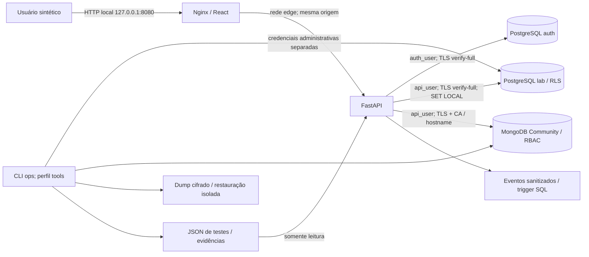

# SecureDB Lab

## Relatório técnico acadêmico

FACAMP - Tratamento e Armazenamento da Informação

Professor: Prof. Me. Nivaldo T. Marcusso

Integrantes: ____________________________________

RA: ___________________________________________

Data de consolidação: 11/11/2026.

## 1. Problema e objetivo

Como transformar requisitos de segurança em controles configurados e evidências verificáveis em bancos relacionais e documentais? O objetivo é implementar os dois laboratórios com dados sintéticos, separar autorização de interface e comprovar cenários positivos e negativos, sem confundir existência de código com eficácia observada.

## 2. Ambiente e alcance observado

Execução registrada: **Windows nativo / bancos reais / TLS verificado / Compose não executado**. Timestamp UTC da suíte: 2026-11-11T17:19:08.159968+00:00.

Resultado: **33 PASS, 0 FAIL e 0 SKIP**. O painel comprova 17/20 controles no perfil registrado; 3 exigem observações adicionais.

O Docker Desktop instalado falhou antes de disponibilizar o motor, por erro interno na inicialização de socket. Foram usados PostgreSQL portátil e MongoDB Community nativos, com TLS verificando CA/hostname e portas em loopback. O Compose foi fornecido e validado estaticamente; não há alegação de execução de contêineres ou de CI remota bem-sucedida.

- test_sql_environment: {"server_version": "17.6", "persistent_tables": ["lab.tenants", "lab.customers", "lab.orders"], "unicode_data": "UTF-8 verified", "profile": "Windows nativo / bancos reais / TLS verificado / Compose não executado"}
- test_mongo_environment: {"server_version": "8.0.8", "edition": "Community"}

As versões Python/Node/dependências e as auditorias estão nos artefatos de entrega. Tags de imagem fixadas não equivalem a digests. Não foi alegada varredura das imagens que não puderam ser iniciadas.

## 3. Arquitetura e limites de confiança


O SecureDB Lab implementa os dois laboratórios da disciplina Tratamento e Armazenamento da Informação. React/TypeScript/Vite compõem a interface; FastAPI/Pydantic aplicam autenticação, autorização e validação; psycopg 3 e PyMongo acessam os bancos com verificação de CA e hostname.



## Fronteiras

1. **Navegador / servidor:** a empresa nunca é aceita no payload. A sessão opaca é persistida como hash SHA-256; seu mapeamento para a conta determina tenant e papel. Campos extras são rejeitados. Mudanças exigem Origin autorizado e token CSRF da sessão. A política SameSite e HttpOnly complementa esses controles.
2. **Servidor / PostgreSQL:** `auth_user` tem leitura de contas e operações de sessão. `api_user` herda leitura/escrita restritas de negócio; não lê hashes nem administra o banco. O proprietário `migration_owner` é NOLOGIN e não é herdado pela aplicação. Cada operação de negócio abre uma conexão/transação e define tenant e ator com `set_config(..., true)`.
3. **RLS:** tenants, customers e orders usam ENABLE e FORCE RLS. As políticas têm USING e WITH CHECK. A FK composta impede associar pedido a cliente de outra empresa. Roles privilegiadas e contexto de backend comprometido continuam sendo limites do desenho.
4. **Servidor / MongoDB:** usuário restrito a find/insert/update nas coleções products e profiles; sem administração, remoção ou bypass de validação. O escopo por empresa é aplicado pelo backend, sem alegação de RLS no MongoDB. `$jsonSchema`, índices únicos e validação strict/error são aplicados no SGBD.
5. **Operação:** o serviço ops é separado e opcional. Apenas ele recebe credenciais administrativas e chave de backup. A API recebe o diretório de evidências somente para leitura e nunca executa comandos de teste, backup ou restore pelo navegador.

## Redes e persistência

O Compose usa PostgreSQL 17.6 e MongoDB 8.0.15, volumes nomeados e healthchecks. Bancos conectam-se somente à rede interna `data` (172.29.74.0/24) e não publicam portas. Web publica apenas `127.0.0.1:8080`. A API liga as redes edge/data. `bindIp: 0.0.0.0` do MongoDB é necessário para acesso dos pares de rede e depende dessa segmentação; não representa proteção isoladamente. O host deve ter firewall compatível. ENV-01 inspeciona o contêiner e a rede efetivos, sem montar o socket Docker no runtime.

O perfil alternativo nativo Windows usa apenas `127.0.0.1:55432` e `127.0.0.1:57017` e pastas `.local/native`. Ele valida banco/API e TLS, mas não certifica a topologia de contêineres. A API local de desenvolvimento usa 127.0.0.1:8000 e o Vite 127.0.0.1:5173 com proxy de mesma origem.

## Segredos e criptografia

`scripts/lab.py setup` gera senhas aleatórias, CA RSA de 3072 bits e certificados com SAN dos serviços, localhost e 127.0.0.1. Não sobrescreve material parcial ou expirado silenciosamente. O diretório `.local` e `.env` são ignorados. Clientes validam cadeia e hostname; nenhum usa tlsAllowInvalidCertificates ou sslmode=require como substituto de verify-full.

O navegador em HTTP é uma escolha restrita ao laboratório local; o cookie tem Secure=false nesse contexto. TLS entre API e banco é uma fronteira distinta. Backups são cifrados com AES-256-GCM, incluem autenticação de integridade e são restaurados a partir do conteúdo salvo e decriptado. Tempos de dump/restore são medidos, sem alegar RTO/RPO de negócio atingidos.

## 4. Procedimento reproduzível

A fundação usa setup idempotente para segredos, certificados e sementes; a aplicação aplica papéis/tenant no backend. A CLI executa teste e restore, e o painel lê JSON sanitizado. O procedimento principal e o alternativo estão no README.

```text
python scripts/lab.py setup
python scripts/lab.py up
python scripts/lab.py seed
python scripts/lab.py test
python scripts/lab.py backup --database both
python scripts/lab.py restore --database both
python scripts/lab.py report
python scripts/lab.py preflight
python scripts/lab.py stop
```

Os comandos Docker acima são o fluxo disponibilizado para execução final, não um registro de que todos rodaram neste computador. A execução efetivamente observada usou scripts/native.py e pytest com LAB_INTEGRATION=1; os comandos e limites estão em docs/VALIDACAO.md.

## 5. Controles e comprovação

| Controle | Resultado | Testes requeridos |
|---|---|---|
| SQL-01 - Ambiente isolado | IMPLEMENTADO SEM VALIDAÇÃO | test_sql_environment, ENV-01 |
| SQL-02 - Roles segregadas | IMPLEMENTADO E TESTADO | test_sql_roles |
| SQL-03 - Menor privilégio | IMPLEMENTADO E TESTADO | test_sql_privileges |
| SQL-04 - SCRAM e origem | IMPLEMENTADO E TESTADO | test_sql_authentication |
| SQL-05 - TLS verify-full | IMPLEMENTADO E TESTADO | test_sql_tls |
| SQL-06 - Isolamento por RLS | IMPLEMENTADO E TESTADO | test_sql_rls_direct, test_api_tenant_access, test_api_write_scope, test_sql_context_reset |
| SQL-07 - Consultas parametrizadas | IMPLEMENTADO E TESTADO | test_sql_injection, test_api_validation |
| SQL-08 - Trilha de auditoria | IMPLEMENTADO E TESTADO | test_sql_audit |
| SQL-09 - Backup e restauração | IMPLEMENTADO E TESTADO | test_sql_backup |
| SQL-10 - Checklist e testes finais | IMPLEMENTADO E TESTADO | test_sql_final |
| NOSQL-01 - Ambiente isolado | IMPLEMENTADO SEM VALIDAÇÃO | test_mongo_environment, ENV-01 |
| NOSQL-02 - Administrador separado | IMPLEMENTADO E TESTADO | test_mongo_admin_separation |
| NOSQL-03 - Autenticação obrigatória | IMPLEMENTADO E TESTADO | test_mongo_anonymous |
| NOSQL-04 - RBAC por coleção | IMPLEMENTADO E TESTADO | test_mongo_rbac |
| NOSQL-05 - Rede restrita | IMPLEMENTADO SEM VALIDAÇÃO | test_mongo_network, ENV-01 |
| NOSQL-06 - TLS obrigatório | IMPLEMENTADO E TESTADO | test_mongo_tls |
| NOSQL-07 - Schema no SGBD | IMPLEMENTADO E TESTADO | test_mongo_schema |
| NOSQL-08 - Filtros tipados | IMPLEMENTADO E TESTADO | test_mongo_injection |
| NOSQL-09 - Backup e restauração | IMPLEMENTADO E TESTADO | test_mongo_backup |
| NOSQL-10 - Checklist e testes finais | IMPLEMENTADO E TESTADO | test_mongo_final |

## 6. Testes positivos e negativos

| ID | Resultado | Objetivo |
|---|---|---|
| test_api_authentication | PASS | Login aceito/negado, sessão invalidada e endpoint sem identidade. |
| test_api_tenant_access | PASS | Empresa A não lê ID da B; B consulta o mesmo ID normalmente. |
| test_api_write_scope | PASS | SELECT/INSERT/UPDATE entre empresas e operação legítima na A. |
| test_api_viewer_and_csrf | PASS | test_api_viewer_and_csrf |
| test_api_validation | PASS | test_api_validation |
| test_api_mongo_tenant_and_crud | PASS | test_api_mongo_tenant_and_crud |
| test_mongo_environment | PASS | test_mongo_environment |
| test_mongo_admin_separation | PASS | test_mongo_admin_separation |
| test_mongo_anonymous | PASS | test_mongo_anonymous |
| test_mongo_rbac | PASS | test_mongo_rbac |
| test_mongo_network | PASS | test_mongo_network |
| test_mongo_tls | PASS | test_mongo_tls |
| test_mongo_schema | PASS | test_mongo_schema |
| test_mongo_injection | PASS | test_mongo_injection |
| test_mongo_backup | PASS | test_mongo_backup |
| test_mongo_final | PASS | test_mongo_final |
| test_sql_environment | PASS | test_sql_environment |
| test_sql_roles | PASS | test_sql_roles |
| test_sql_privileges | PASS | test_sql_privileges |
| test_sql_authentication | PASS | test_sql_authentication |
| test_sql_tls | PASS | test_sql_tls |
| test_sql_rls_direct | PASS | test_sql_rls_direct |
| test_sql_context_reset | PASS | test_sql_context_reset |
| test_sql_injection | PASS | test_sql_injection |
| test_sql_audit | PASS | test_sql_audit |
| test_sql_backup | PASS | test_sql_backup |
| test_sql_final | PASS | test_sql_final |
| test_payloads_reject_mass_assignment | PASS | test_payloads_reject_mass_assignment |
| test_filters_reject_operators_and_escape_regex | PASS | test_filters_reject_operators_and_escape_regex |
| test_unsafe_origin_denied_before_database | PASS | test_unsafe_origin_denied_before_database |
| test_controls_require_complete_evidence | PASS | test_controls_require_complete_evidence |
| test_restore_guard_refuses_source | PASS | test_restore_guard_refuses_source |
| test_certificates_and_encrypted_backup | PASS | test_certificates_and_encrypted_backup |

## 7. Backup e restauração medidos

### test_sql_backup
Destino novo: `restore_pg_8ddece9d8dcd4df39958855c37486bc2`. Dump: **0.2369 s**. Restore e verificação: **0.4836 s**. Cópia mantida: AES-256-GCM. Snapshot consistente: sim (PostgreSQL).

| Estrutura | Origem | Restaurado | Fingerprint |
|---|---|---|---|
| lab.tenants | 2 | 2 | igual |
| lab.customers | 3 | 3 | igual |
| lab.orders | 12 | 12 | igual |

O hash completo e o nome do artefato cifrado estão no JSON do teste. Os tempos não são um benchmark e não comprovam RTO/RPO de negócio.

### test_mongo_backup
Destino novo: `restore_mongo_fe0298a68c4d48ab853499ef6f651c59`. Dump: **0.1075 s**. Restore e verificação: **0.2044 s**. Cópia mantida: AES-256-GCM. Snapshot consistente: não (MongoDB standalone; escritas devem ser pausadas).

| Estrutura | Origem | Restaurado | Fingerprint |
|---|---|---|---|
| products | 13 | 13 | igual |
| profiles | 10 | 10 | igual |

O hash completo e o nome do artefato cifrado estão no JSON do teste. Os tempos não são um benchmark e não comprovam RTO/RPO de negócio.

## 8. Simuladores e evolução


Use os simuladores existentes no HTML original. Os valores são **informados pelo aluno**, mesmo quando derivados de medições. Não constituem teste automatizado nem auditoria formal. Nenhum cenário inicial foi coletado nesta execução; a comparação antes/depois permanece pendente de coleta humana, sem reconstrução fictícia do passado.

## 1. Governança de SI

Registre os dez domínios, nota 0-5, peso, justificativa e caminho de evidência: IAM 12; MFA/PAM 10; criptografia 11; rede 10; hardening 9; logging 10; BCM 12; DevSecOps 9; privacidade 8; risco/compliance 9. O índice didático é a soma ponderada das notas dividida por 5 (pesos somam 100). Registre nível e quatro lacunas destacadas. Não conceda nota máxima por haver um arquivo de configuração.

## 2. IAM e exposição

Anote ambiente, banco, privilégio, autenticação administrativa, endpoint público, segredo versionado, recertificação, logs, identidade de workload e break-glass. Compare somente alterações comprovadas e cite controles SQL-02/03/04 e NOSQL-02/03/04/05. Uma senha estática de serviço não é identidade de workload federada. Não marque MFA/PAM ou recertificação sem processo real.

## 3. BCM / RTO / RPO

Defina requisitos do cenário fictício com justificativa do aluno, sem apresentá-los como requisito do professor. Copie `backup_seconds` e `restore_seconds` dos testes SQL-09/NOSQL-09, considerando que o tempo de recuperação do serviço completo inclui mais que o restore do banco. Frequência de backup não foi automatizada; logo, não há RPO operacional garantido. HA, offsite, imutabilidade e plano de DR completo permanecem ausentes. Cópia AES-GCM no mesmo host não atende sozinha 3-2-1-1-0.

## 4. Plano de evolução

Registre nível atual/alvo, gap, prioridade e ambiente. Propostas P1: (a) backups agendados/offsite/imutáveis e chave em cofre; (b) identidade administrativa com MFA/PAM e revisão de acesso; (c) centralização de logs, retenção e alertas. Responsáveis: preencher pelo grupo. Evidências esperadas: execução e logs de restore, revisão assinada de acesso e alerta observado. São propostas, não controles existentes.

## Coleta

Salve em `evidencias/simuladores/` os quatro pares de capturas quando houver cenário inicial verdadeiro, justificativas em Markdown e um JSON com `origem: informado pelo aluno`, data, parâmetros, resultado, evidência e limitações. Se não houver captura inicial, registre “não coletado”; não simule uma captura retroativa. Revise limitações da fórmula do HTML antes de interpretar mudanças de pontuação como ganho real de segurança.

## 9. Riscos residuais


Este laboratório usa exclusivamente dados sintéticos. Seus controles demonstram cenários delimitados; não constituem uma certificação de segurança nem uma configuração pronta para produção.

| Risco residual | Impacto | Controle existente | Próxima medida |
|---|---|---|---|
| Backend comprometido altera o GUC de tenant | Leitura/escrita entre empresas SQL | RLS com USING e WITH CHECK; contexto vindo da sessão; parametrização | Identidades de banco por tenant ou contexto assinado, revisão de código e testes adicionais |
| Conta MongoDB de negócio acessa duas empresas | Exposição entre empresas após comprometimento da API | Filtros de tenant obrigatórios na API; RBAC por coleção | Credenciais/bases por empresa quando a fronteira exigir isolamento no SGBD |
| Host ou administrador comprometido | Controle de bancos, logs e chaves | Serviços de baixo privilégio e credenciais separadas | Hardening do host, PAM/MFA, gestão de segredos e segregação operacional |
| Backups e chave no mesmo host | Perda simultânea ou decriptação por invasor do host | AES-256-GCM, restauração em base separada, fingerprint | Offsite, imutabilidade e cofre externo para a chave |
| Backup sem agenda/PITR | RPO indefinido entre execuções manuais | Rotina reprodutível e tempos medidos | Agenda, retenção, alertas e PITR conforme BIA |
| MongoDB standalone durante escritas | Dump pode não representar um instante consistente | Comparação antes/depois; orientação para pausar escritas | Replica set e estratégia de backup consistente conforme a versão |
| Navegador em HTTP local | Cookie sem atributo Secure e canal local sem TLS | Bind 127.0.0.1, HttpOnly, SameSite Strict, CSRF e verificação de Origin | HTTPS de ponta a ponta e Secure antes de uso remoto |
| Logs modificáveis e cobertura limitada | Lacunas de investigação | Eventos da API, trigger SQL, logs de conexão/DDL | Centralização, retenção, imutabilidade e alertas; Community sem Enterprise audit |
| Sem MFA/SSO na aplicação | Acesso após furto de senha | Argon2id, sessão de duas horas e limitador local de login | Provedor OIDC/MFA; sessões e rate limiting distribuídos |
| Dependências e imagens envelhecem | Vulnerabilidades futuras | Versões registradas, lockfile, SCA e dependabot | Revalidar boletins e atualizar com testes; tags não são digests imutáveis |
| Rede de dados compartilhada no Compose | Movimento lateral após comprometimento de um contêiner | Rede interna sem publicação dos bancos; TLS e autenticação | Separar redes por banco e políticas de saída conforme necessidade |
| Subnet fixa colide com rede do host | Ambiente não inicia ou roteamento incorreto | Subnet explícita documentada | Ajustar conjuntamente Compose e pg_hba, e reexecutar a suíte |

Não há HA, failover, SIEM, replicação, KMS, WAF, auditoria Enterprise ou certificação ISO implementados. A verificação de rede do Compose depende de ENV-01; uma execução nativa em Windows não comprova esse item.

Os dumps incluem hashes de contas e sessões. Apenas a cópia cifrada é mantida em `.local/backups`; o material temporário claro é removido após a operação normal. Chaves privadas, credenciais e logs brutos não integram a entrega Git. Exclusão de arquivo temporário não equivale a apagamento forense do disco.

## 10. Questões dissertativas


Enunciados originais preservados. As respostas abaixo são subsídios técnicos para revisão individual do aluno, e não declaração de autoria do grupo. As configurações foram implementadas; a validação observada e seu perfil devem ser conferidos em `evidencias/entrega/resultado_integrado.json` e no relatório.

## 1. Explique por que a aplicação não deve utilizar uma conta administrativa do PostgreSQL. Relacione sua resposta às roles criadas no laboratório e aos princípios de least privilege e segregação de funções.

**Conceito.** Mínimo privilégio limita cada identidade às operações necessárias; segregação de funções separa uso, evolução e administração do banco.

**Risco.** Uma credencial de DBA na API transforma uma falha de aplicação em capacidade de criar usuários, alterar políticas, ler todos os dados ou remover estruturas.

**Configuração implementada.** `migration_owner` é NOLOGIN e proprietário das estruturas. `app_read` e `app_write` são grupos sem login, herdados por `api_user`. Este não tem SUPERUSER, CREATEDB, CREATEROLE, REPLICATION ou BYPASSRLS. `auth_user` acessa contas/sessões e não tabelas de negócio. O bootstrap usa administrador separado.

**Evidência observável.** `test_sql_roles` verifica atributos, proprietário e memberships; `test_sql_privileges` aceita SELECT legítimo e nega CREATE TABLE, TRUNCATE, leitura de auth.accounts e SET ROLE migration_owner. Ver SQL-02/03 e os JSON da execução, cujo perfil está explicitado no relatório.

**Limitação ou risco residual.** O proprietário e o administrador conservam poderes elevados. O comprometimento integral do backend também pode atingir suas duas credenciais; a separação reduz permissões, mas não cria uma fronteira física entre os processos.

**Revisão individual do aluno:** pendente. Nome/RA e ajustes: ____________________.

## 2. Considere que o PostgreSQL foi instalado em um servidor interno. Descreva como pg_hba.conf, firewall, SCRAM e TLS trabalham juntos para reduzir o risco de acesso indevido ao banco.

**Conceito.** Firewall restringe alcance da porta; pg_hba define origem, usuário, base e método; SCRAM autentica por desafio/resposta; TLS cifra o tráfego e permite verificar o servidor.

**Risco.** Uma senha forte não impede alcance indevido da rede nem interceptação se o cliente não validar certificado e hostname. TLS não limita o que um usuário autenticado pode consultar.

**Configuração implementada.** O Compose define rede interna sem portas dos bancos publicadas. Regras hostssl aceitam apenas as identidades/bases previstas na subnet de dados e rejeitam plaintext e demais origens. password_encryption usa scram-sha-256; psycopg usa verify-full e CA local. O perfil nativo troca a subnet por loopback.

**Evidência observável.** `test_sql_authentication` confere verificador SCRAM e credencial inválida; `test_sql_tls` observa pg_stat_ssl e nega plaintext/hostname errado. ENV-01 inspeciona Docker efetivo quando disponível. Nesta entrega, a execução nativa não comprova a regra de uma origem estrangeira de rede de contêineres.

**Limitação ou risco residual.** Firewall real do host e alcance a partir de uma rede externa não foram certificados nesta execução. A CA é didática e seus 90 dias de validade exigem renovação planejada.

**Revisão individual do aluno:** pendente. Nome/RA e ajustes: ____________________.

## 3. No cenário multiempresa, explique como Row-Level Security ajuda a impedir que um usuário de uma empresa consulte pedidos de outra. Indique também uma limitação do uso de RLS.

**Conceito.** RLS restringe as linhas visíveis e graváveis no SGBD, mesmo quando uma consulta da aplicação não contém WHERE de tenant.

**Risco.** Confiar em tenant_id do navegador permitiria forjar contexto. Políticas somente de leitura também deixariam lacunas de inserção ou atualização.

**Configuração implementada.** Tenants, customers e orders têm ENABLE/FORCE RLS e políticas USING/WITH CHECK. O backend obtém tenant da conta autenticada e executa set_config com is_local=true na transação. A FK composta liga cliente e pedido na mesma empresa. A conta runtime não é proprietária nem tem BYPASSRLS.

**Evidência observável.** `test_sql_rls_direct` observa leitura vazia, UPDATE de zero linhas e INSERT negado no contexto A contra B. `test_api_tenant_access` e `test_api_write_scope` verificam IDs/URLs, criação e alteração. `test_sql_context_reset` reutiliza a conexão após commit e confirma ausência de contexto remanescente.

**Limitação ou risco residual.** O GUC de contexto pode ser alterado por quem já controla a sessão SQL; logo, não protege de um backend comprometido ou de SQL arbitrário. Superusers/BYPASSRLS continuam fora da proteção. RLS não substitui revisão de views, funções e privilégios globais.

**Revisão individual do aluno:** pendente. Nome/RA e ajustes: ____________________.

## 4. Explique por que prepared statements são essenciais mesmo quando a aplicação já valida campos do formulário. Use um exemplo do laboratório para diferenciar validação de entrada e parametrização.

**Conceito.** Validação confirma formato, tipo, faixa e regra de negócio. Parametrização mantém dados separados da estrutura do comando SQL.

**Risco.** Entradas válidas como texto ainda podem conter aspas ou trechos semelhantes a comandos. A concatenação permitiria que dados mudassem a lógica da consulta.

**Configuração implementada.** A pesquisa de clientes usa ILIKE com placeholder %s e tupla de parâmetros; o driver executa com prepare=True. Pedidos têm UUID, limite de texto e Decimal positivo com duas casas. Não se interpola entrada na sintaxe SQL.

**Evidência observável.** `test_sql_injection` envia uma busca legítima e a string adversarial inofensiva com aspas/OR. A segunda retorna zero resultados, mantendo o filtro de tenant e tratando a entrada como dado. `test_api_validation` recusa mass assignment de tenant_id e tipos indevidos.

**Limitação ou risco residual.** Validação e parametrização não concedem autorização. Identificadores SQL dinâmicos, quando necessários na operação de restore, usam psycopg.sql.Identifier e uma allowlist de tabelas; não placeholders de valores.

**Revisão individual do aluno:** pendente. Nome/RA e ajustes: ____________________.

## 5. Proponha um conjunto mínimo de logs, alertas e evidências de backup/restore que deveriam ser mantidos para demonstrar segurança e capacidade de recuperação do banco SQL.

**Conceito.** Auditoria registra quem fez o quê e quando; continuidade exige cópia recuperável e evidência de restauração, não apenas um comando de dump concluído.

**Risco.** Sem logs de login/DDL/privilégios e eventos críticos, uma alteração pode passar sem atribuição. Backup não testado pode falhar quando necessário.

**Configuração implementada.** Logs nativos registram conexão/desconexão e DDL; a API grava eventos estruturados sem corpo/token/senha; um trigger SQL registra ator, operação, tenant e pedido. O dump usa snapshot exportado e a cópia mantida usa AES-256-GCM. Restore cria uma base com prefixo protegido e nome novo.

**Evidência observável.** `test_sql_audit` verifica INSERT do pedido na trilha e presença real de conexão, DDL e falha de autenticação no log, exportando somente flags sanitizadas. `test_sql_backup` compara contagens e fingerprints de tenants/customers/orders após restauração, registrando duração.

**Limitação ou risco residual.** Não há SIEM/alertas automáticos/retencão imutável. Proponho alertas de falhas repetidas de autenticação, mudanças de privilégios, falha de backup e atraso de restore test. A cópia local e a chave no mesmo host não satisfazem recuperação de desastre; RTO/RPO precisam de requisitos e operação contínua.

**Revisão individual do aluno:** pendente. Nome/RA e ajustes: ____________________.

## 6. Explique a diferença entre a conta administrativa e a conta da aplicação. Quais riscos surgem quando a aplicação recebe permissões além das necessárias?

**Conceito.** A conta administrativa gerencia identidades, esquemas e tarefas operacionais; a conta da aplicação executa o caso de uso dentro de privilégios delimitados.

**Risco.** Uma API com root ou privilégio de mudar validadores pode criar usuários, neutralizar controles e ampliar o alcance de um vazamento.

**Configuração implementada.** `lab_admin` tem papel root para bootstrap e operações isoladas, fora da API. `api_user` autentica em lab e herda catalog_api, com find/insert/update apenas em products/profiles. Não tem remove, createUser, collMod ou bypassDocumentValidation.

**Evidência observável.** `test_mongo_admin_separation` observa connectionStatus e identidade distinta. `test_mongo_rbac` aceita leitura e recusa usersInfo administrativo, createUser, collMod e escrita em coleção não concedida com código 13.

**Limitação ou risco residual.** O acesso da aplicação cobre documentos de duas empresas e a fronteira entre elas é implementada no servidor. RBAC por coleção não equivale a isolamento por linha/documento de tenant.

**Revisão individual do aluno:** pendente. Nome/RA e ajustes: ____________________.

## 7. Considere uma API que aceite filtros MongoDB enviados diretamente pelo cliente. Explique como operadores como $ne ou $where podem ser abusados e como a aplicação deve validar os filtros.

**Conceito.** Operadores MongoDB são parte da linguagem de consulta. Aceitar o objeto do cliente como filtro permite que ele determine a semântica da busca.

**Risco.** $ne pode ampliar igualdade para desigualdade; $where pode introduzir expressões de JavaScript em configurações que o habilitem. Repassar JSON arbitrário cria uma superfície além dos filtros de produto previstos.

**Configuração implementada.** CatalogQuery só aceita q, category e limit, com extra=forbid, enum e limites. Objetos e caracteres de operador não são aceitos no texto. O servidor monta tenant_id a partir da sessão e usa re.escape para a busca literal. JavaScript server-side está desabilitado na configuração.

**Evidência observável.** `test_mongo_injection` e `test_api_validation` rejeitam q[$ne], $where, JSON indevido e objeto no preço com HTTP 422. A busca por metacaracteres .* não amplia os resultados. A escrita/consulta entre empresas também é verificada pela API.

**Limitação ou risco residual.** A defesa depende de todos os caminhos usarem a construção de filtros revisada. Índices, limites e autorização continuam necessários para desempenho e proteção de dados; bloquear um caractere sozinho não é uma solução geral.

**Revisão individual do aluno:** pendente. Nome/RA e ajustes: ____________________.

## 8. Por que utilizar JSON Schema em um banco orientado a documentos considerado flexível? Relacione a resposta com integridade, qualidade dos dados e segurança.

**Conceito.** Flexibilidade documental permite evolução, mas não elimina invariantes de integridade e de segurança. JSON Schema estabelece contrato no ponto persistente.

**Risco.** Sem um contrato, preços negativos, tipos incorretos ou campos inesperados podem quebrar regras de negócio, gerar interpretações divergentes e contaminar os dados.

**Configuração implementada.** Produtos e perfis têm $jsonSchema strict/error com campos obrigatórios, tipos BSON, faixas, enumerações e additionalProperties=false. _id e tenant_id têm formato previsto; índices únicos reforçam SKU/e-mail por empresa. A API possui validação adicional com Pydantic.

**Evidência observável.** `test_mongo_schema` grava diretamente via PyMongo, sem passar pelo formulário/Pydantic: produto/perfil válido é aceito e documento inválido é recusado pelo MongoDB com código 121. Assim se distingue uma rejeição do SGBD de uma rejeição apenas na interface.

**Limitação ou risco residual.** Esquema não verifica veracidade, autorização de tenant nem finalidade de uso dos dados. Migrações e evolução do contrato precisam de revisão e teste de compatibilidade.

**Revisão individual do aluno:** pendente. Nome/RA e ajustes: ____________________.

## 9. Descreva como bindIp, firewall e TLS se complementam para proteger o MongoDB. Explique por que criptografia em trânsito não substitui controle de rede.

**Conceito.** bindIp seleciona interfaces de escuta; firewall/segmentação limitam origens; TLS protege confidencialidade/integridade do canal e verifica o endpoint.

**Risco.** Um endpoint público com TLS ainda aceita tentativas de autenticação de origens indesejadas. Criptografar tráfego não reduz por si só a superfície de rede.

**Configuração implementada.** Dentro do Compose, MongoDB escuta em 0.0.0.0 para atender API/ops na rede interna; não publica porta e exige TLS. O perfil nativo escuta exclusivamente em 127.0.0.1. PyMongo verifica CA/hostname, sem flags para aceitar certificado inválido.

**Evidência observável.** `test_mongo_network` observa getCmdLineOpts do servidor. `test_mongo_tls` aceita canal verificado e recusa plaintext, CA não confiável e hostname errado. ENV-01 é necessário para comprovar a ausência de publicação no Compose; não foi executado com o motor Docker indisponível.

**Limitação ou risco residual.** A configuração declarada de rede deve ser confrontada com o ambiente efetivo. O teste nativo de loopback não certifica firewall externo, roteadores ou regras de produção.

**Revisão individual do aluno:** pendente. Nome/RA e ajustes: ____________________.

## 10. Após concluir o laboratório NoSQL, identifique três riscos que ainda podem permanecer mesmo com autenticação, TLS, RBAC e backup configurados. Proponha controles adicionais.

**Conceito.** Risco residual é a exposição que persiste depois dos controles, considerando seu alcance, o processo operacional e ameaças ainda plausíveis.

**Risco.** Três riscos permanecem: credencial/host comprometido; cópia e chave perdidas no mesmo domínio de falha; dependência ou configuração vulnerável após a entrega.

**Configuração implementada.** O laboratório usa conta limitada, TLS, validação e dump cifrado/restauração isolada. As medidas adicionais propostas são, respectivamente: MFA/PAM e rotação/cofre; offsite/imutabilidade e agenda/PITR apropriado; patching, SCA contínua, revisão de migrations e alertas.

**Evidência observável.** A tabela versionada em docs/riscos_residuais.md liga risco, impacto, controle e próxima medida. NOSQL-09 registra restore e igualdade de dados; as auditorias de dependências têm relatórios próprios com a data. Propostas não são registradas como controles existentes.

**Limitação ou risco residual.** A execução em standalone exige cuidado com consistência durante escritas. Não há evidência de HA, disaster recovery completo ou cumprimento de RTO/RPO de negócio; esses pontos não podem receber pontuação fictícia nos simuladores.

**Revisão individual do aluno:** pendente. Nome/RA e ajustes: ____________________.

## 11. Conclusão

A execução observou 33 cenários, com 33 aprovações. Os resultados sustentam as afirmações delimitadas sobre autenticação, autorização, TLS, integridade e recuperação no perfil testado. Persistem a validação de implantação em contêineres, a coleta humana de simuladores e a revisão individual das respostas. O laboratório não certifica robustez universal ou prontidão para produção.

## 12. Bibliografia e materiais

- MARCUSSO, Nivaldo T. Manual do Aluno: Segurança da Informação e Cibersegurança em Bancos de Dados. FACAMP, 2026, v2, 18 páginas. Arquivo original e hash no manifesto de fontes.

- FACAMP. Apresentação interativa de Segurança da Informação e Cibersegurança em Bancos de Dados, v3. Laboratórios e entregas nos slides 71-78; os simuladores permanecem no HTML original.

- Prompt mestre SecureDB Lab fornecido pelo aluno; especificação complementar de produto.

- PostgreSQL 17. Row Security Policies. https://www.postgresql.org/docs/17/ddl-rowsecurity.html

- PostgreSQL 17. SSL Support. https://www.postgresql.org/docs/17/ssl-tcp.html

- PostgreSQL 17. pg_dump. https://www.postgresql.org/docs/17/app-pgdump.html

- MongoDB. TLS/SSL. https://www.mongodb.com/docs/manual/core/security-transport-encryption/

- MongoDB. Schema Validation. https://www.mongodb.com/docs/manual/core/schema-validation/

- OWASP. SQL Injection Prevention Cheat Sheet. https://cheatsheetseries.owasp.org/cheatsheets/SQL_Injection_Prevention_Cheat_Sheet.html
