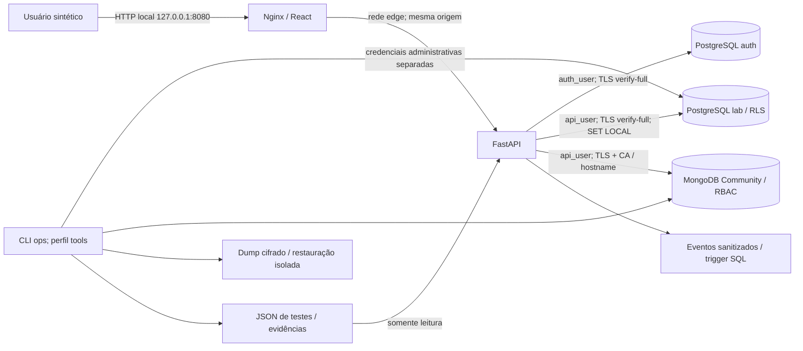

# SecureDB Lab

## Relatório técnico acadêmico

FACAMP - Tratamento e Armazenamento da Informação

Professor: Prof. Me. Nivaldo T. Marcusso

Identificação acadêmica disponível na versão de entrega do grupo.

Data de consolidação: 11/11/2026.

## 1. Problema e objetivo

Como transformar requisitos de segurança em controles configurados e evidências verificáveis em bancos relacionais e documentais? O objetivo é implementar os dois laboratórios com dados sintéticos, separar autorização de interface e comprovar cenários positivos e negativos, sem confundir existência de código com eficácia observada.

## 2. Ambiente e alcance observado

Execução registrada: **Docker Compose / macOS Apple Silicon / validação local parcial**. Timestamp UTC da suíte: 2026-11-11T20:54:12.218726+00:00.

Resultado (inclui ENV-01 quando registrado): **29 PASS, 0 FAIL e 0 SKIP**. O painel comprova 16/20 controles no perfil registrado; 4 exigem observações adicionais.

A suíte foi registrada no perfil Docker Compose, com drivers reais e TLS verificado. ENV-01 registrou os contêineres ativos, bancos sem portas publicadas e rede interna. A seleção local excluiu verificações específicas de injection e os checklists finais dependentes delas. Capturas, resultados e escopo estão em evidencias/entrega/macos_local.

- test_sql_environment: {"server_version": "17.6 (Debian 17.6-2.pgdg12+1)", "persistent_tables": ["lab.tenants", "lab.customers", "lab.orders"], "unicode_data": "UTF-8 verified", "profile": "Docker Compose / macOS Apple Silicon / validação local parcial"}
- test_mongo_environment: {"server_version": "8.0.15", "edition": "Community"}

As versões Python/Node/dependências e as auditorias estão nos artefatos de entrega. Tags de imagem fixadas não equivalem a digests. Não foi alegada varredura das imagens que não puderam ser iniciadas.

O fluxo portátil e a preparação GitHub estão em docs/instalacao_macos.md e docs/PRONTIDAO_GITHUB.md. O histórico Windows e seus limites estão em docs/VALIDACAO.md. Os artefatos anteriores foram preservados; as evidências deste relatório pertencem ao perfil registrado.

## 3. Arquitetura e limites de confiança


O SecureDB Lab implementa os dois laboratórios da disciplina Tratamento e Armazenamento da Informação. React/TypeScript/Vite compõem a interface; FastAPI/Pydantic aplicam autenticação, autorização e validação; psycopg 3 e PyMongo acessam os bancos com verificação de CA e hostname.



## Fronteiras

1. **Navegador / servidor:** a empresa nunca é aceita no payload. A sessão opaca é persistida como hash SHA-256; seu mapeamento para a conta determina tenant e papel. Campos extras são rejeitados. Mudanças exigem Origin autorizado e token CSRF da sessão. A política SameSite e HttpOnly complementa esses controles.
2. **Servidor / PostgreSQL:** `auth_user` tem leitura de contas e operações de sessão. `api_user` herda leitura/escrita restritas de negócio; não lê hashes nem administra o banco. O proprietário `migration_owner` é NOLOGIN e não é herdado pela aplicação. Cada operação de negócio abre uma conexão/transação e define tenant e ator com `set_config(..., true)`.
3. **RLS:** tenants, customers e orders usam ENABLE e FORCE RLS. As políticas têm USING e WITH CHECK. A FK composta impede associar pedido a cliente de outra empresa. Roles privilegiadas e contexto de backend comprometido continuam sendo limites do desenho.
4. **Servidor / MongoDB:** usuário restrito a find/insert/update nas coleções products e profiles; sem administração, remoção ou bypass de validação. O escopo por empresa é aplicado pelo backend, sem alegação de RLS no MongoDB. `$jsonSchema`, índices únicos e validação strict/error são aplicados no SGBD.
5. **Operação:** o serviço ops é separado e opcional. Apenas ele recebe credenciais administrativas e chave de backup. A API recebe o diretório de evidências somente para leitura e nunca executa comandos de teste, backup ou restore pelo navegador.

## Redes e persistência

O Compose usa PostgreSQL 17.6 e MongoDB 8.0.15, volumes nomeados e healthchecks. Bancos conectam-se somente à rede interna `data` (172.29.74.0/24) e não publicam portas. Web publica apenas `127.0.0.1:8080`. A API liga as redes edge/data. `bindIp: 0.0.0.0` do MongoDB é necessário para acesso dos pares de rede e depende dessa segmentação; não representa proteção isoladamente. O host deve ter firewall compatível. ENV-01 inspeciona o contêiner e a rede efetivos, sem montar o socket Docker no runtime.

O perfil alternativo nativo Windows usa apenas `127.0.0.1:55432` e `127.0.0.1:57017` e pastas `.local/native`. Ele valida banco/API e TLS, mas não certifica a topologia de contêineres. A API local de desenvolvimento usa 127.0.0.1:8000 e o Vite 127.0.0.1:5173 com proxy de mesma origem.

## Segredos e criptografia

`scripts/lab.py setup` gera senhas aleatórias, CA RSA de 3072 bits e certificados com SAN dos serviços, localhost e 127.0.0.1. Não sobrescreve material parcial ou expirado silenciosamente. O diretório `.local` e `.env` são ignorados. Clientes validam cadeia e hostname; nenhum usa tlsAllowInvalidCertificates ou sslmode=require como substituto de verify-full.

O navegador em HTTP é uma escolha restrita ao laboratório local; o cookie tem Secure=false nesse contexto. TLS entre API e banco é uma fronteira distinta. Backups são cifrados com AES-256-GCM, incluem autenticação de integridade e são restaurados a partir do conteúdo salvo e decriptado. Tempos de dump/restore são medidos, sem alegar RTO/RPO de negócio atingidos.

## 4. Procedimento reproduzível

A fundação usa setup idempotente para segredos, certificados e sementes; a aplicação aplica papéis/tenant no backend. A CLI executa teste e restore, e o painel lê JSON sanitizado. O procedimento principal e o alternativo estão no README.

```text
sh scripts/docker.sh up
sh scripts/docker.sh test
sh scripts/docker.sh backup --database both
sh scripts/docker.sh restore --database both
sh scripts/docker.sh report
sh scripts/docker.sh down
```

Os comandos descrevem o fluxo portátil disponibilizado. Somente os testes e observações presentes neste relatório comprovam execução; não foi inferido resultado de CI ou de outro host. O histórico nativo está em docs/VALIDACAO.md.

## 5. Controles e comprovação

| Controle | Resultado | Testes requeridos |
|---|---|---|
| SQL-01 - Ambiente isolado | IMPLEMENTADO E TESTADO | test_sql_environment, ENV-01 |
| SQL-02 - Roles segregadas | IMPLEMENTADO E TESTADO | test_sql_roles |
| SQL-03 - Menor privilégio | IMPLEMENTADO E TESTADO | test_sql_privileges, test_api_viewer_and_csrf |
| SQL-04 - SCRAM e origem | IMPLEMENTADO E TESTADO | test_sql_authentication |
| SQL-05 - TLS verify-full | IMPLEMENTADO E TESTADO | test_sql_tls |
| SQL-06 - Isolamento por RLS | IMPLEMENTADO E TESTADO | test_sql_rls_direct, test_api_tenant_access, test_api_write_scope, test_sql_context_reset |
| SQL-07 - Consultas parametrizadas | IMPLEMENTADO SEM VALIDAÇÃO | test_sql_injection, test_api_validation |
| SQL-08 - Trilha de auditoria | IMPLEMENTADO E TESTADO | test_sql_audit |
| SQL-09 - Backup e restauração | IMPLEMENTADO E TESTADO | test_sql_backup |
| SQL-10 - Checklist e testes finais | IMPLEMENTADO SEM VALIDAÇÃO | test_sql_final |
| NOSQL-01 - Ambiente isolado | IMPLEMENTADO E TESTADO | test_mongo_environment, ENV-01 |
| NOSQL-02 - Administrador separado | IMPLEMENTADO E TESTADO | test_mongo_admin_separation |
| NOSQL-03 - Autenticação obrigatória | IMPLEMENTADO E TESTADO | test_mongo_anonymous |
| NOSQL-04 - RBAC por coleção | IMPLEMENTADO E TESTADO | test_mongo_rbac, test_api_viewer_and_csrf |
| NOSQL-05 - Rede restrita | IMPLEMENTADO E TESTADO | test_mongo_network, ENV-01 |
| NOSQL-06 - TLS obrigatório | IMPLEMENTADO E TESTADO | test_mongo_tls |
| NOSQL-07 - Schema no SGBD | IMPLEMENTADO E TESTADO | test_mongo_schema |
| NOSQL-08 - Filtros tipados | IMPLEMENTADO SEM VALIDAÇÃO | test_mongo_injection, test_profile_search |
| NOSQL-09 - Backup e restauração | IMPLEMENTADO E TESTADO | test_mongo_backup |
| NOSQL-10 - Checklist e testes finais | IMPLEMENTADO SEM VALIDAÇÃO | test_mongo_final |

## 6. Testes positivos e negativos

| ID | Resultado | Objetivo |
|---|---|---|
| test_sql_environment | PASS | test_sql_environment |
| test_sql_roles | PASS | test_sql_roles |
| test_sql_privileges | PASS | test_sql_privileges |
| test_sql_authentication | PASS | test_sql_authentication |
| test_sql_tls | PASS | test_sql_tls |
| test_sql_rls_direct | PASS | test_sql_rls_direct |
| test_sql_context_reset | PASS | test_sql_context_reset |
| test_sql_audit | PASS | test_sql_audit |
| test_sql_backup | PASS | test_sql_backup |
| test_mongo_environment | PASS | test_mongo_environment |
| test_mongo_admin_separation | PASS | test_mongo_admin_separation |
| test_mongo_anonymous | PASS | test_mongo_anonymous |
| test_mongo_rbac | PASS | test_mongo_rbac |
| test_mongo_network | PASS | test_mongo_network |
| test_mongo_tls | PASS | test_mongo_tls |
| test_mongo_schema | PASS | test_mongo_schema |
| test_mongo_backup | PASS | test_mongo_backup |
| test_api_authentication | PASS | Login aceito/negado, sessão invalidada e endpoint sem identidade. |
| test_api_tenant_access | PASS | Empresa A não lê ID da B; B consulta o mesmo ID normalmente. |
| test_api_write_scope | PASS | SELECT/INSERT/UPDATE entre empresas e operação legítima na A. |
| test_api_viewer_and_csrf | PASS | test_api_viewer_and_csrf |
| test_api_mongo_tenant_and_crud | PASS | test_api_mongo_tenant_and_crud |
| test_profile_search | PASS | Pesquisa literal de nome/e-mail/segmento e rejeição de operador/tenant. |
| test_environment_export_and_profile_scope | PASS | test_environment_export_and_profile_scope |
| test_control_details_have_real_source_and_specific_scenarios | PASS | test_control_details_have_real_source_and_specific_scenarios |
| test_desktop_paths_and_cleanup_stay_inside_project | PASS | test_desktop_paths_and_cleanup_stay_inside_project |
| test_desktop_restart_clears_old_stop_before_gui | PASS | test_desktop_restart_clears_old_stop_before_gui |
| test_docker_http_proxy_login_and_isolation | PASS | test_docker_http_proxy_login_and_isolation |
| ENV-01 | PASS | Contêineres ativos, rede interna exclusiva e bancos sem portas publicadas |

## 7. Backup e restauração medidos

### test_sql_backup
Destino novo: `restore_pg_2221582682384cdab20c24b21bb23489`. Dump: **0.1082 s**. Restore e verificação: **0.1472 s**. Cópia mantida: AES-256-GCM. Snapshot consistente: sim (PostgreSQL).

| Estrutura | Origem | Restaurado | Fingerprint |
|---|---|---|---|
| lab.tenants | 2 | 2 | igual |
| lab.customers | 3 | 3 | igual |
| lab.orders | 6 | 6 | igual |

O hash completo e o nome do artefato cifrado estão no JSON do teste. Os tempos não são um benchmark e não comprovam RTO/RPO de negócio.

### test_mongo_backup
Destino novo: `restore_mongo_50831345609f4af59ce756eacaccf1f0`. Dump: **0.0298 s**. Restore e verificação: **0.1116 s**. Cópia mantida: AES-256-GCM. Snapshot consistente: não (MongoDB standalone; escritas devem ser pausadas).

| Estrutura | Origem | Restaurado | Fingerprint |
|---|---|---|---|
| products | 7 | 7 | igual |
| profiles | 5 | 5 | igual |

O hash completo e o nome do artefato cifrado estão no JSON do teste. Os tempos não são um benchmark e não comprovam RTO/RPO de negócio.

## 8. Simuladores e evolução

Fonte: apresentação FACAMP, slides 67–70, e Manual do Aluno, pp. 5–8. Os simuladores foram executados no HTML original em 11/11/2026. A versão acadêmica inclui as capturas. O cenário inicial dos simuladores 1 a 3 ficou **não coletado**. Os resultados abaixo registram o cenário atual e, no simulador 3, uma hipótese de planejamento. Os valores e as recomendações calculadas estão em `evidencias/simuladores/resultados-macos.json`.

## 1. Governança de SI — 31/100, nível 2 (Repetível)

| Domínio | Nota / 5 | Justificativa |
|---|---|---|
| IAM | 2 | Papéis segregados e operações permitidas e negadas verificadas nos dois bancos. |
| MFA/PAM | 0 | Administração por senha, sem MFA/PAM demonstrados. |
| Criptografia | 2 | TLS verificado nos bancos e restauração a partir de backups cifrados. |
| Rede | 2 | ENV-01 observou a rede interna do Compose e os bancos sem portas publicadas. |
| Hardening | 1 | Configurações de segurança registradas. Falta rotina de revisão e atualização. |
| Logging/SIEM | 2 | Eventos de conexão e DDL observados no PostgreSQL e trilha da aplicação. Falta centralização e alerta. |
| BCM/DR | 2 | Restaurações verificadas em bases separadas. Backups sob demanda no mesmo host. |
| DevSecOps | 1 | Testes locais repetíveis. Evidência limitada de automação contínua. |
| Privacidade/LGPD | 2 | Dados sintéticos e separação por empresa. Governança de retenção e conformidade ainda por definir. |
| Risco/compliance | 1 | Riscos residuais documentados. Falta rotina de revisão e definição de responsáveis. |

O HTML destacou MFA/PAM, hardening, DevSecOps e gestão de riscos.

## 2. IAM e exposição — 60/100, postura Controlada

Ambiente local (on-premises), SQL + NoSQL, mínimo privilégio e segregação, senha administrativa forte, endpoint público desmarcado e auditoria marcada pelos logs locais. O item de senha em código/.env real foi marcado porque a instalação gera um .env local com credenciais. O arquivo é ignorado pelo Git. Recertificação, identidade federada de workload e acesso de emergência controlado ficaram desmarcados. Evidências: ENV-01, SQL-02/03/04/08 e NOSQL-02/03/04/05.

## 3. BCM — cenário hipotético, 36/100, Insuficiente

As restaurações foram medidas com dados pequenos. PostgreSQL: dump de 0,1082 s, restauração e verificação de 0,1472 s. MongoDB: dump de 0,0298 s, restauração e verificação de 0,1116 s. Os destinos separados foram verificados nos testes SQL-09 e NOSQL-09. Esses tempos medem a recuperação dos bancos com os dados do teste.

O simulador exige uma frequência. Como os backups reais são manuais, o campo foi preenchido com uma **hipótese** diária para mostrar a lacuna em relação a um RPO proposto de 8 horas. O exercício usa RTO proposto de 1 hora e estimativa de 30 minutos para recuperar o serviço, incluindo atividades além do restore. Os valores representam um cenário didático para discussão. A única opção marcada foi backup criptografado. A restauração observada foi pontual e a opção de teste periódico ficou desmarcada. Na operação atual, a frequência manual deixa o RPO sem garantia.

## 4. Plano de evolução — nível 2 para 3

O HTML calculou lacuna de 1 nível e esforço baixo para o foco de redução de risco em ambiente local. A tabela transforma as recomendações do simulador em ações do grupo, com responsáveis propostos por função. A revisão periódica fica em P3 como etapa de acompanhamento definida para a entrega.

| Prioridade | Ação proposta | Responsável proposto | Evidência esperada |
|---|---|---|---|
| P1 | Revisar acesso administrativo, avaliar MFA/PAM e atualizar o registro de riscos. | Segurança e infraestrutura | Matriz de acesso revisada e registro de riscos com responsáveis. |
| P2 | Definir periodicidade e retenção de backups, separar a cópia e testar a restauração. | Administração dos bancos | Agenda, registro de restauração e comparação dos dados. |
| P2 | Centralizar logs e formalizar a revisão de privilégios e de atualizações. | Operação e segurança | Evento recebido no destino e registro da revisão. |
| P3 | Revisar as ações após novo exercício e atualizar a pontuação com as evidências obtidas. | Grupo | Comparação datada e inventário de controles atualizado. |

## 9. Riscos residuais


Este laboratório usa exclusivamente dados sintéticos. Seus controles demonstram cenários delimitados; não constituem uma certificação de segurança nem uma configuração pronta para produção.

| Risco residual | Impacto | Controle existente | Próxima medida |
|---|---|---|---|
| Backend comprometido altera o GUC de tenant | Leitura/escrita entre empresas SQL | RLS com USING e WITH CHECK; contexto vindo da sessão; parametrização | Identidades de banco por tenant ou contexto assinado, revisão de código e testes adicionais |
| Conta MongoDB de negócio acessa duas empresas | Exposição entre empresas após comprometimento da API | Filtros de tenant obrigatórios na API; RBAC por coleção | Credenciais/bases por empresa quando a fronteira exigir isolamento no SGBD |
| Host ou administrador comprometido | Controle de bancos, logs e chaves | Serviços de baixo privilégio e credenciais separadas | Hardening do host, PAM/MFA, gestão de segredos e segregação operacional |
| Backups e chave no mesmo host | Perda simultânea ou decriptação por invasor do host | AES-256-GCM, restauração em base separada, fingerprint | Offsite, imutabilidade e cofre externo para a chave |
| Backup sem agenda/PITR | RPO indefinido entre execuções manuais | Rotina reprodutível e tempos medidos | Agenda, retenção, alertas e PITR conforme BIA |
| MongoDB standalone durante escritas | Dump pode não representar um instante consistente | Comparação antes/depois; orientação para pausar escritas | Replica set e estratégia de backup consistente conforme a versão |
| Navegador em HTTP local | Cookie sem atributo Secure e canal local sem TLS | Bind 127.0.0.1, HttpOnly, SameSite Strict, CSRF e verificação de Origin | HTTPS de ponta a ponta e Secure antes de uso remoto |
| Logs modificáveis e cobertura limitada | Lacunas de investigação | Eventos da API, trigger SQL, logs de conexão/DDL | Centralização, retenção, imutabilidade e alertas; Community sem Enterprise audit |
| Sem MFA/SSO na aplicação | Acesso após furto de senha | Argon2id, sessão de duas horas e limitador local de login | Provedor OIDC/MFA; sessões e rate limiting distribuídos |
| Dependências e imagens envelhecem | Vulnerabilidades futuras | Versões registradas, lockfile, SCA e dependabot | Revalidar boletins e atualizar com testes; tags não são digests imutáveis |
| Rede de dados compartilhada no Compose | Movimento lateral após comprometimento de um contêiner | Rede interna sem publicação dos bancos; TLS e autenticação | Separar redes por banco e políticas de saída conforme necessidade |
| Subnet fixa colide com rede do host | Ambiente não inicia ou roteamento incorreto | Subnet explícita documentada | Ajustar conjuntamente Compose e pg_hba, e reexecutar a suíte |

Não há HA, failover, SIEM, replicação, KMS, WAF, auditoria Enterprise ou certificação ISO implementados. A verificação de rede do Compose depende de ENV-01; uma execução nativa em Windows não comprova esse item.

Os dumps incluem hashes de contas e sessões. Apenas a cópia cifrada é mantida em `.local/backups`; o material temporário claro é removido após a operação normal. Chaves privadas, credenciais e logs brutos não integram a entrega Git. Exclusão de arquivo temporário não equivale a apagamento forense do disco.

## 10. Questões dissertativas


Respostas para apresentação oral, com exemplos dos laboratórios e evidências da execução local quando disponíveis. As questões seguem os slides 76 e 77 e o Manual do Aluno, pp. 16–17.

## 1. Explique por que a aplicação não deve utilizar uma conta administrativa do PostgreSQL. Relacione sua resposta às roles criadas no laboratório e aos princípios de least privilege e segregação de funções.

A aplicação não deve usar uma conta administrativa porque essa conta tem muitos privilégios. Se a aplicação for invadida, alguém poderia alterar ou excluir dados e até modificar configurações importantes do banco. Por isso, o ideal é criar roles com permissões específicas, como uma para consultas e outra para as operações de escrita necessárias. Isso aplica o privilégio mínimo, ou seja, cada conta recebe apenas o acesso de que precisa. Também respeita a segregação de funções, separando a administração das tarefas comuns da aplicação. No laboratório, isso pode ser demonstrado mostrando as permissões das roles e uma operação administrativa negada à conta da aplicação.

## 2. Considere que o PostgreSQL foi instalado em um servidor interno. Descreva como pg_hba.conf, firewall, SCRAM e TLS trabalham juntos para reduzir o risco de acesso indevido ao banco.

Esses quatro recursos funcionam como camadas de proteção. O firewall limita quais máquinas conseguem chegar à porta do banco. O arquivo pg_hba.conf determina quais usuários, bancos e origens podem tentar uma conexão e qual método de autenticação será exigido. O SCRAM faz a verificação de senha de forma mais segura, e o TLS criptografa a comunicação para proteger os dados em trânsito. Assim, não dependemos de uma única barreira. Como evidência, podemos apresentar a regra de conexão segura, uma tentativa de acesso bloqueada e uma conexão estabelecida com TLS.

## 3. No cenário multiempresa, explique como Row-Level Security ajuda a impedir que um usuário de uma empresa consulte pedidos de outra. Indique também uma limitação do uso de RLS.

A RLS é uma segurança em nível de linha. Ela permite definir regras para que cada empresa consiga consultar apenas os pedidos que pertencem a ela, mesmo que todas utilizem a mesma tabela. Por exemplo, a empresa A não deve enxergar os registros da empresa B. Isso ajuda a evitar vazamento de informações entre clientes. Uma limitação é que superusuários podem ignorar essa proteção; além disso, regras mal configuradas ou um identificador de empresa informado incorretamente podem comprometer o isolamento. Para comprovar o controle, podemos testar a consulta de uma empresa e verificar que os pedidos da outra não aparecem.

## 4. Explique por que prepared statements são essenciais mesmo quando a aplicação já valida campos do formulário. Use um exemplo do laboratório para diferenciar validação de entrada e parametrização.

A validação verifica se o dado digitado está no formato esperado, como um e-mail válido ou um número. Já os prepared statements, usados com parâmetros, separam os dados do comando SQL. Assim, mesmo que alguém digite um texto malicioso, o banco trata esse conteúdo como valor, e não como parte da consulta. Por exemplo, em um campo de login ou de busca, a entrada do usuário deve ser enviada como parâmetro, nunca colada diretamente no SQL. Por isso, validar e parametrizar são cuidados diferentes e complementares: um confere a entrada e o outro previne que ela altere a estrutura do comando.

## 5. Proponha um conjunto mínimo de logs, alertas e evidências de backup/restore que deveriam ser mantidos para demonstrar segurança e capacidade de recuperação do banco SQL.

Para demonstrar segurança, o banco deve registrar tentativas de login, falhas de autenticação, mudanças de permissões, alterações importantes na estrutura do banco e operações críticas. Também é útil ter alertas para muitas tentativas de acesso, privilégios elevados inesperadamente e atividades fora do padrão. Para a recuperação, não basta guardar um backup: precisamos registrar quando ele foi feito, se terminou corretamente e se foi possível restaurar os dados em um teste. Isso se relaciona ao BCM, que busca manter ou recuperar a operação, e aos conceitos de RTO (tempo aceitável para recuperar o serviço) e RPO (quantidade aceitável de dados perdidos). As evidências seriam logs, alertas, registros dos backups e uma restauração testada.

## 6. Explique a diferença entre a conta administrativa e a conta da aplicação. Quais riscos surgem quando a aplicação recebe permissões além das necessárias?

No MongoDB, a conta administrativa é usada para gerenciar o banco, seus usuários e suas configurações. A conta da aplicação deve ter acesso apenas às coleções e operações necessárias para o sistema funcionar. O RBAC organiza isso por meio de papéis e permissões. Se a aplicação receber privilégios demais e for comprometida, alguém poderá consultar informações indevidas, modificar registros ou até apagar dados que não deveria. Por isso, usamos contas separadas e permissões mínimas. Uma forma de comprovar essa separação é mostrar os papéis configurados e testar que a conta da aplicação não consegue executar uma ação administrativa.

## 7. Considere uma API que aceite filtros MongoDB enviados diretamente pelo cliente. Explique como operadores como $ne ou $where podem ser abusados e como a aplicação deve validar os filtros.

O problema é deixar o cliente enviar um filtro que o MongoDB execute sem controle. Um atacante pode usar operadores como $ne para mudar o sentido de uma comparação e tentar contornar uma verificação, ou $where para introduzir uma condição de consulta perigosa. Para evitar isso, a aplicação precisa validar os tipos dos valores, aceitar apenas os campos e operadores realmente necessários e montar o filtro no servidor. Por exemplo, se a API espera um nome como texto, ela não deve aceitar no lugar dele um objeto com operadores MongoDB. O teste de segurança consiste em enviar uma entrada inesperada e verificar que ela seja rejeitada.

## 8. Por que utilizar JSON Schema em um banco orientado a documentos considerado flexível? Relacione a resposta com integridade, qualidade dos dados e segurança.

Embora o MongoDB permita documentos flexíveis, isso não significa que qualquer informação deva ser aceita. O JSON Schema ajuda a definir quais campos são obrigatórios, quais tipos de dados são permitidos e quais regras os documentos precisam seguir. Por exemplo, um pedido pode exigir um identificador, um valor numérico e um status válido. Isso melhora a qualidade e a integridade dos dados, além de reduzir a entrada de informações inesperadas que poderiam provocar erros na aplicação. No laboratório, a evidência é tentar inserir um documento inválido e verificar que o banco o rejeita. Essa validação complementa, mas não substitui, os controles de acesso e a validação da aplicação.

## 9. Descreva como bindIp, firewall e TLS se complementam para proteger o MongoDB. Explique por que criptografia em trânsito não substitui controle de rede.

O bindIp define em quais interfaces de rede o MongoDB aceita conexões. O firewall restringe quais máquinas podem alcançar o serviço. Já o TLS criptografa os dados transmitidos entre a aplicação e o banco. Esses controles se complementam porque protegem partes diferentes da conexão. Mesmo com TLS, deixar a porta do MongoDB acessível para qualquer origem continua aumentando o risco de tentativas de acesso indevido. Ou seja, criptografar a comunicação não significa autorizar todas as conexões. Para demonstrar a proteção, podemos mostrar a configuração do bindIp, as regras de rede e uma conexão usando TLS.

## 10. Após concluir o laboratório NoSQL, identifique três riscos que ainda podem permanecer mesmo com autenticação, TLS, RBAC e backup configurados. Proponha controles adicionais.

Mesmo com esses recursos, ainda existem riscos. O primeiro é o roubo de credenciais: alguém pode conseguir uma senha válida; para reduzir isso, devemos proteger e trocar os segredos, além de limitar os privilégios. O segundo é uma falha na aplicação, como NoSQL Injection, que pode permitir consultas indevidas; para evitá-la, precisamos validar as entradas e montar os filtros com segurança. O terceiro é descobrir que o backup está corrompido ou não restaura os dados quando necessário; por isso, devemos testar o restore periodicamente e manter cópias protegidas. Esses exemplos mostram o risco residual: a segurança reduz a chance e o impacto dos problemas, mas não elimina todos eles.

## 11. Conclusão

A execução observou 29 cenários, com 29 aprovações. Os resultados sustentam as afirmações delimitadas sobre autenticação, autorização, TLS, integridade e recuperação no perfil testado. Os controles sem comprovação continuam pendentes. Os simuladores registram o cenário atual, uma hipótese de continuidade e o plano de evolução. O cenário inicial ficou não coletado. O grupo deve revisar as respostas e validar as metas e os responsáveis propostos no plano. O laboratório não certifica robustez universal ou prontidão para produção.

## 12. Bibliografia e materiais

- MARCUSSO, Nivaldo T. Manual do Aluno: Segurança da Informação e Cibersegurança em Bancos de Dados. FACAMP, 2026, v2, 18 páginas. Arquivo original e hash no manifesto de fontes.

- FACAMP. Apresentação interativa de Segurança da Informação e Cibersegurança em Bancos de Dados, v3. Laboratórios e entregas nos slides 71-78; os simuladores permanecem no HTML original.

- Prompt mestre SecureDB Lab fornecido pelo aluno; especificação complementar de produto.

- PostgreSQL 17. Row Security Policies. https://www.postgresql.org/docs/17/ddl-rowsecurity.html

- PostgreSQL 17. SSL Support. https://www.postgresql.org/docs/17/ssl-tcp.html

- PostgreSQL 17. pg_dump. https://www.postgresql.org/docs/17/app-pgdump.html

- MongoDB. TLS/SSL. https://www.mongodb.com/docs/manual/core/security-transport-encryption/

- MongoDB. Schema Validation. https://www.mongodb.com/docs/manual/core/schema-validation/

- OWASP. SQL Injection Prevention Cheat Sheet. https://cheatsheetseries.owasp.org/cheatsheets/SQL_Injection_Prevention_Cheat_Sheet.html
